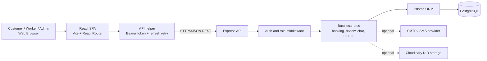
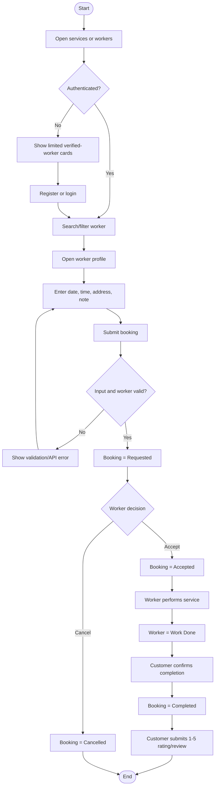
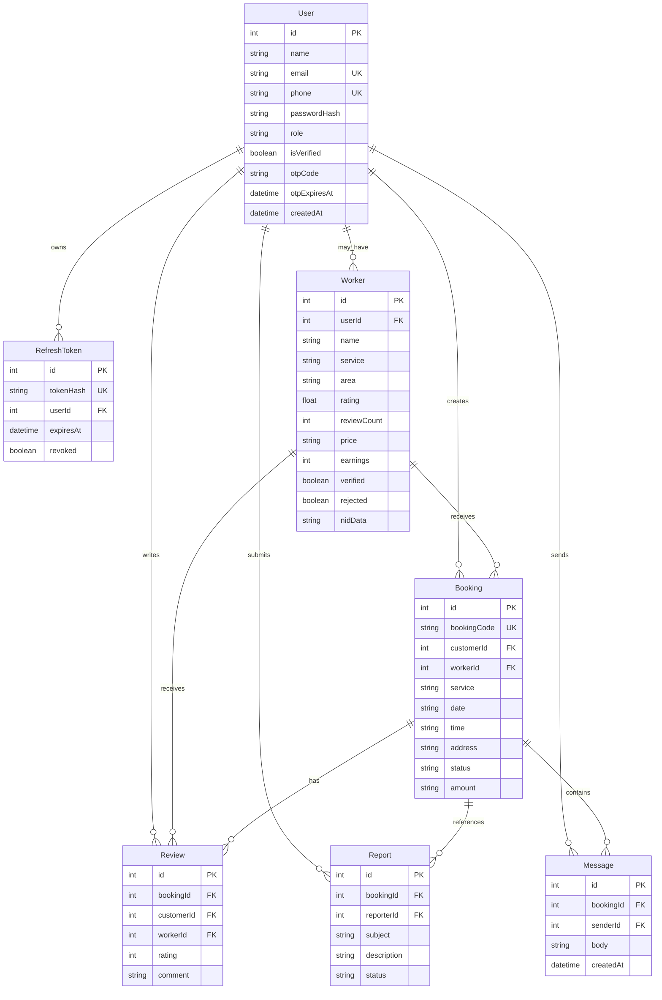

# SheboyHaat
## A Trust-Based Booking Platform for Local Home-Service Workers

> **Project report and technical description**  
> **Project type:** Full-stack web application  
> **Primary repository:** `SheboyHaat/`  
> **Document status:** Based on the implementation currently present in the repository

---

## Abstract

SheboyHaat is a web-based local home-service booking platform designed to connect customers with trusted service workers in Bangladesh. It addresses the difficulty of finding reliable plumbers, electricians, cleaners, AC technicians, appliance repairers, and painters through informal contacts or unverified online listings. Customers can browse service categories, search verified workers, inspect worker profiles, create bookings, communicate through booking-specific chat, track service progress, complete jobs, and submit reviews. Workers can register with their service information and National ID document, manage booking requests, update job status, view earnings, and communicate with customers. Administrators verify or reject worker applications, monitor platform statistics, inspect database records, and review submitted reports.

The frontend is implemented with React 18, React Router, Vite, and responsive CSS with English/Bangla localization. The backend uses Node.js, Express, JWT access tokens, HTTP-only refresh-token cookies, bcrypt password hashing, Nodemailer/SMS-ready OTP delivery, Cloudinary-ready document storage, and Prisma ORM connected to PostgreSQL. The result is a role-aware platform prototype with a clear trust and verification workflow. It provides a foundation for a production marketplace while also demonstrating authentication, relational data modeling, authorization, booking lifecycle management, and responsive user experience design.

---

## Table of Contents

| Section | Page |
|---|---:|
| Abstract | i |
| Table of Contents | ii |
| 1. Introduction | 1 |
| 1.1 Project Overview | 1 |
| 1.2 Problem Statement | 2 |
| 1.3 Objectives / Goals | 2 |
| 1.4 Scope of the Project | 3 |
| 1.5 Target Users | 3 |
| 1.6 Limitations | 4 |
| 2. Literature Review / Related Work | 5 |
| 3. Requirement Analysis | 7 |
| 3.1 Functional Requirements | 7 |
| 3.2 Non-Functional Requirements | 10 |
| 3.3 Hardware Requirements | 11 |
| 3.4 Software Requirements | 12 |
| 4. System Design | 14 |
| 4.1 Architecture Diagram | 14 |
| 4.2 Use Case Diagram | 15 |
| 4.3 Activity Diagram / Flowchart | 16 |
| 4.4 Database Design | 18 |
| 4.5 UI Design | 20 |
| 5. Implementation / Development | 23 |
| 5.1 Tools and Technologies | 23 |
| 5.2 Module Description | 25 |
| 5.3 Key Code Snippets | 31 |
| 5.4 Screenshots and Working Screens | 35 |
| 6. Testing | 39 |
| 6.1 Testing Strategy | 39 |
| 6.2 Bugs Found and Fixes | 41 |
| 7. Results and Discussion | 43 |
| 8. Conclusion and Future Work | 46 |
| 8.1 Conclusion | 46 |
| 8.2 Future Enhancements | 47 |

*Page numbers are an editable report layout guide and should be updated after the document is placed into Word/PDF format.*

---

# 1. Introduction

## 1.1 Project Overview

SheboyHaat is a two-sided marketplace for local home services. It provides one place where:

- customers can discover and book local service workers;
- workers can advertise their skills and manage jobs; and
- administrators can validate workers and supervise platform activity.

The application separates the public discovery experience from authenticated service details. A visitor can see service categories and a limited worker directory, but detailed worker information and area filtering are available after login. This supports the platform’s trust model: users are encouraged to create an account before receiving full marketplace information.

The project has two runnable parts:

1. **Frontend:** A Vite-powered React single-page application in `frontend/`.
2. **Backend:** An Express REST API in `backend/`, connected to PostgreSQL through Prisma.

The root setup script installs dependencies, creates the local environment file from the example, synchronizes and seeds the database, and starts the frontend and backend development servers.

## 1.2 Problem Statement

People who need household repairs or maintenance often depend on personal recommendations, social-media posts, or unknown technicians. These methods create several problems:

- worker identity and skill level may not be verified;
- price and availability are unclear;
- customers have no consistent booking record;
- service communication is scattered across phone calls and messaging apps;
- workers have difficulty building a trusted professional profile; and
- there is no central process for complaints or administrator review.

SheboyHaat solves this problem by creating a structured service marketplace with worker verification, searchable profiles, booking status transitions, customer-worker communication, review aggregation, and administrator supervision.

## 1.3 Objectives / Goals

The main objectives are:

1. Build a simple local-service discovery and booking website.
2. Provide separate experiences for customers, workers, and administrators.
3. Establish trust through worker verification and identity-document submission.
4. Allow customers to search by service, area, and worker name.
5. Manage a booking from request to acceptance, work completion, and review.
6. Store users, workers, bookings, reviews, reports, and messages persistently.
7. Support secure authentication with password hashing, OTP verification, JWT sessions, and refresh tokens.
8. Provide English and Bangla interface text and localized numbers.
9. Keep the interface responsive and usable on desktop and mobile browsers.
10. Create a maintainable foundation for future payments, notifications, and deployment.

## 1.4 Scope of the Project

### Included

- customer and worker registration;
- email and Bangladeshi phone validation;
- email OTP verification with development fallback;
- login, logout, session restoration, and token refresh;
- service-category browsing;
- verified-worker directory;
- keyword, service, and area filtering;
- worker profile and review display;
- customer booking creation;
- worker booking acceptance, work-completion, and cancellation;
- customer job completion;
- booking-specific chat;
- customer reviews and worker rating recalculation;
- worker earnings and completed-job counters;
- worker NID upload through Cloudinary when configured;
- administrator worker verification or rejection;
- administrator overview, database view, and report view;
- customer reports/complaints;
- account profile editing and account deletion;
- bilingual English/Bangla interface;
- responsive presentation and local development setup.

### Outside the current scope

- online payment gateway and automatic refunds;
- live location/GPS tracking;
- calendar synchronization;
- push notifications;
- native Android/iOS applications;
- automated worker background checks;
- production-grade analytics and observability;
- multi-admin permission levels;
- a complete public cloud deployment configuration.

## 1.5 Target Users

### Customers

People who need household services and want to compare workers, book a service, communicate with the worker, confirm completion, and leave a review.

### Service workers

Plumbers, electricians, cleaners, AC technicians, appliance repairers, painters, and similar local professionals who want a verified online profile and a way to receive and manage jobs.

### Administrators

Platform operators who validate worker identity documents, approve or reject worker profiles, monitor bookings and reports, and inspect system data.

## 1.6 Limitations

1. The frontend still contains some prototype content, including home-page statistics and fallback sample worker cards.
2. The actual marketplace directory is database-backed, but public users receive limited worker data until authentication.
3. Payment is represented by a displayed amount only; no money is collected.
4. OTP delivery requires SMTP or an SMS provider in production. Without one, development mode prints or returns the OTP for demonstration.
5. NID data falls back to a data URL when Cloudinary is not configured. This is suitable for demonstration, not for large-scale production storage.
6. Chat is request-based REST chat rather than WebSocket real-time messaging.
7. No automated unit or end-to-end testing framework is included in the repository.
8. The seeded administrator credentials are demo credentials and must be replaced before deployment.
9. The backend has a development fallback JWT secret if `JWT_SECRET` is not configured.
10. The default CORS policy is intentionally restricted to local development origins and needs an explicit production policy.
11. Worker availability, schedule conflicts, cancellation fees, and service-area expansion are not yet modeled.

---

# 2. Literature Review / Related Work

## 2.1 Similar Web Applications

SheboyHaat belongs to the same broad category as:

- online local-service marketplaces;
- home-maintenance booking websites;
- classified service directories;
- ride and delivery marketplaces that match customers with providers; and
- appointment-booking systems.

Common patterns in these systems include provider profiles, category search, customer requests, status tracking, ratings, and administrative moderation. General marketplace platforms often provide a much larger geographic and commercial scope, while appointment systems focus on scheduling rather than local worker verification.

## 2.2 How SheboyHaat Is Different

SheboyHaat is designed specifically around the local Bangladesh home-service context:

- it uses Bangladeshi phone-number validation and Bangladeshi currency formatting;
- it supports both English and Bangla interface text;
- it treats NID submission and administrator verification as a core worker-onboarding step;
- it provides a simple workflow suitable for customers who may not use complex marketplace systems;
- it keeps the booking conversation attached to the booking instead of requiring a separate messaging identity; and
- it displays a trust-oriented interface with verification badges, ratings, completed jobs, and complaint reporting.

The project is intentionally smaller than a commercial marketplace. Its value is the combination of localized UX, an explicit verification process, and a complete academic full-stack implementation.

## 2.3 References and Technical Foundations

The implementation follows established patterns from:

- React component-based single-page application design;
- REST API design using HTTP methods and JSON;
- Express middleware for authentication, authorization, error handling, and CORS;
- Prisma relational data modeling and migrations/schema synchronization;
- PostgreSQL relational integrity and foreign-key relationships;
- bcrypt password hashing;
- JWT access-token authentication;
- HTTP-only refresh-token cookies;
- responsive CSS layouts and accessible form controls.

The repository’s own README files and source code are the primary project references. External service integrations are represented by their official Node.js libraries or HTTP APIs, including Nodemailer and Cloudinary.

---

# 3. Requirement Analysis

## 3.1 Functional Requirements

### FR-01: Public browsing

The system shall allow a visitor to:

- open the home page;
- view the six service categories;
- read the three-step “how it works” explanation;
- open the services page;
- open the worker directory; and
- read help, notes, and informational pages.

### FR-02: Registration

The system shall allow a user to register as a customer or worker. Required common data includes name, email, password, and Bangladeshi phone number. Worker registration additionally requires service, area, experience, and price. The worker may upload the NID during registration or from the worker dashboard within 14 days; the application remains hidden until the NID is submitted and approved.

The backend validates the role, email, phone number, password length, duplicate email, and duplicate phone number. Passwords are stored as bcrypt hashes.

### FR-03: OTP verification

The system shall:

- generate a six-digit OTP using a cryptographically secure random number;
- hash the OTP before storing it;
- apply an expiry time;
- send it through configured email/SMS delivery; and
- allow verification and resending.

Development mode can expose the OTP for local demonstration when delivery is not configured.

### FR-04: Login and session management

The system shall authenticate users with email and password. A successful session returns a short-lived access token and creates a refresh-token record whose hash is stored in PostgreSQL. The refresh token is sent in an HTTP-only cookie.

The frontend stores the access token and safe user profile in local storage. On an expired access token it calls `/auth/refresh`, obtains a new session, and retries the original request once.

### FR-05: Worker discovery

Authenticated users can search verified workers by:

- worker name;
- service;
- area.

The backend returns verified workers ordered by rating. Unauthenticated users receive limited worker information and a locked-detail presentation.

### FR-06: Worker profiles

A worker profile contains name, service, area, price, verification status, rating, review count, completed-job count, experience, biography, and reviews. Detailed information is requested from the backend rather than trusted from client-only data.

### FR-07: Booking creation

An authenticated customer can choose a verified worker and submit:

- service;
- date;
- time;
- address; and
- optional note.

The server validates the worker, generates a unique booking code such as `SH-1234567`, stores the worker’s current displayed price, and starts the booking in `Requested` status.

### FR-08: Booking lifecycle

The system shall enforce the following transitions:

| Current status | Allowed actor/action | New status |
|---|---|---|
| Requested | Worker accepts | Accepted |
| Accepted | Worker marks work complete | Work Done |
| Accepted or Work Done | Customer confirms completion | Completed |
| Requested, Accepted, or Work Done | Worker cancels | Cancelled |
| Any status | Administrator update, where permitted by the implementation | Controlled administrative update |

When a booking first becomes `Completed`, the worker’s job count increases by one and the numeric part of the amount is added to worker earnings.

### FR-09: Reviews and rating aggregation

Only the customer who owns a completed booking can submit one review. The rating must be an integer from 1 to 5 and the comment cannot exceed 1,000 characters. After insertion, the server recalculates the worker’s average rating and review count.

### FR-10: Booking chat

Customers, the assigned worker, and administrators can read or send messages for an authorized booking. Empty messages are rejected and message length is limited to 2,000 characters. The API supports initial history loading and incremental retrieval using a message ID.

### FR-11: Worker dashboard

Workers can see assigned bookings, accept requests, mark work done, cancel eligible bookings, open a booking chat, and access earnings information. A worker’s profile also shows verification or rejection state.

### FR-12: Worker resubmission

If an administrator rejects a worker, the worker can update the relevant profile/application information and resubmit for review. The admin review card shows the submitted name, email, service, area, phone, experience, price, profile-completion percentage, and NID document. The administrator records the rejection explanation in English and its Bangla translation; both messages are returned to the worker account and displayed in the dashboard and profile. A verified worker receives a 100% profile-completion state and a verified badge.

### FR-13: Administration

Administrators can:

- view counts of workers, pending verifications, bookings, and open reports;
- list worker applications;
- view submitted NID metadata and document URLs where available;
- verify workers;
- reject workers with an English or Bangla reason;
- inspect users, workers, bookings, reviews, and reports; and
- view submitted complaints.

Admin routes use both authentication and a role check.

### FR-14: Reports

An authenticated user can submit a report with subject and description, optionally linked to a booking code. Administrators can list the reports.

### FR-15: Profile and account settings

Users can update their profile name, email, and phone, view profile information, change application settings represented by the frontend, log out, and request account deletion. Account deletion uses a transaction to remove or detach related records while preserving appropriate booking/report history.

### FR-16: Localization and responsive UI

The interface supports English and Bangla translations through `i18n.jsx`. The selected language is persisted in local storage, the document language is updated, and numbers are localized where displayed. CSS media queries adapt grids, forms, navigation, and cards to smaller screens.

## 3.2 Non-Functional Requirements

### Performance

- Use indexed relational lookups for user, worker, booking, message, and refresh-token relationships.
- Fetch only relevant records for role-specific booking lists.
- Use API-level filtering instead of downloading the entire worker database.
- Keep the frontend bundle and page structure suitable for a lightweight local service directory.
- Avoid duplicate refresh requests by sharing an in-progress refresh promise.

### Security

- Hash passwords with bcrypt.
- Hash refresh tokens and OTP values before storage.
- Use short-lived access tokens and revocable refresh tokens.
- Use an HTTP-only cookie for refresh-token transport.
- Apply role-based admin middleware.
- Verify booking ownership before status, review, or chat operations.
- Restrict worker discovery to verified workers.
- Validate email, phone, message, comment, and document inputs.
- Do not expose password hashes or raw refresh tokens in API responses.

### Usability

- Provide clear navigation and role-specific dashboard routes.
- Show verification, pending, rejected, and booking-status badges.
- Provide form hints and validation messages.
- Support English and Bangla.
- Use familiar service icons, cards, buttons, and responsive grids.

### Maintainability

- Keep frontend API behavior in `frontend/src/api.js`.
- Keep database structure in one Prisma schema.
- Use Express middleware for shared authentication and error handling.
- Use environment variables for secrets and external services.
- Use named REST routes with predictable resource paths.

### Reliability

- Restore a session after a browser refresh.
- Reject expired OTPs and expired refresh tokens.
- Use database transactions for account deletion.
- Return explicit HTTP status codes and messages for invalid operations.
- Fail startup when PostgreSQL cannot be connected.

## 3.3 Hardware Requirements

### Client-Side Requirements (End-User Device)

Minimum practical requirements:

- dual-core processor;
- 2 GB RAM;
- 100 MB free storage for browser cache;
- 1,280 × 720 display recommended;
- keyboard/touch input;
- internet or local network access;
- camera/file access only when a worker uploads an NID document.

Recommended:

- 4 GB RAM or more;
- modern smartphone, tablet, laptop, or desktop;
- stable broadband or 4G/5G connection.

### Server-Side Requirements (Hosting Environment)

For a small demonstration deployment:

- 1 virtual CPU;
- 1 GB RAM minimum, 2 GB recommended;
- 5 GB storage for application logs and temporary files;
- Node.js LTS runtime;
- PostgreSQL database or managed PostgreSQL provider;
- HTTPS in production;
- outbound access to SMTP/SMS and Cloudinary if those integrations are enabled.

For larger usage, the API, frontend, database, document storage, and background notification services should be scaled independently.

## 3.4 Software Requirements

### Client-Side Software Requirements

- Windows, Linux, macOS, Android, or iOS;
- Google Chrome, Microsoft Edge, Mozilla Firefox, or Safari;
- JavaScript enabled;
- cookies enabled for refresh-token sessions;
- modern browser with `fetch`, local storage, file input, and ES module support.

### Server-Side and Development Software Requirements

| Area | Requirement |
|---|---|
| Frontend stack | React 18, React DOM, React Router DOM 6, Vite 5 |
| Frontend styling | CSS, responsive grid/flexbox, Google Fonts |
| Backend stack | Node.js, Express 4 |
| Database access | Prisma 7, `@prisma/client`, `@prisma/adapter-pg` |
| DBMS | PostgreSQL |
| Authentication | bcryptjs, jsonwebtoken, HTTP-only cookies |
| Communication | Nodemailer, configurable SMS/Twilio HTTP delivery |
| Document storage | Cloudinary, with development data-URL fallback |
| Middleware | CORS, dotenv, Express JSON parsing |
| Development tools | npm, Prisma CLI, Vite development server |
| Deployment | Node.js hosting plus managed/local PostgreSQL; Cloudinary and SMTP/SMS are optional services |
| Operating system | Any OS supporting Node.js and PostgreSQL connectivity |

Required environment variables include `DATABASE_URL` and, for production, a strong `JWT_SECRET`. Optional variables configure SMTP, SMS/Twilio, Cloudinary, cookie behavior, and token/OTP lifetimes.

---

# 4. System Design

## 4.1 Architecture Diagram

The project uses a client-server REST architecture. The frontend follows a component-oriented single-page application structure. The backend combines route handlers, authentication middleware, validation logic, Prisma data access, and PostgreSQL persistence.

**Figure 4.1: SheboyHaat high-level architecture**



### Request flow

1. The browser renders a React route.
2. A component calls `api()` from `api.js`.
3. The helper adds the access-token header and sends credentials.
4. Express receives the request and applies authentication/authorization middleware.
5. A route validates input and applies business rules.
6. Prisma reads or writes PostgreSQL records.
7. The API returns JSON.
8. React updates component state and presents the result.

## 4.2 Use Case Diagram

**Figure 4.2: Role-based use cases**

```mermaid
flowchart TB
    Customer([Customer])
    Worker([Worker])
    Admin([Administrator])

    subgraph Platform[SheboyHaat Platform]
      Browse[Browse services and workers]
      Auth[Register, verify OTP, login]
      Book[Create booking]
      Track[Track booking status]
      Chat[Chat about booking]
      Review[Review completed service]
      Report[Submit report]
      Profile[Manage profile/account]
      Apply[Submit worker application and NID]
      WorkerJobs[Manage assigned jobs]
      Earnings[View earnings]
      Verify[Verify or reject workers]
      Monitor[Monitor overview, database, reports]
    end

    Customer --> Browse
    Customer --> Auth
    Customer --> Book
    Customer --> Track
    Customer --> Chat
    Customer --> Review
    Customer --> Report
    Customer --> Profile

    Worker --> Auth
    Worker --> Apply
    Worker --> WorkerJobs
    Worker --> Chat
    Worker --> Earnings
    Worker --> Profile

    Admin --> Auth
    Admin --> Verify
    Admin --> Monitor
    Admin --> Chat
```



## 4.3 Activity Diagram / Flowchart

**Figure 4.3: Customer booking activity**



### Authentication activity

Registration creates an unverified account, issues a time-limited OTP, and routes the user to the verification screen. A correct, unexpired OTP marks the account verified and creates a session. Login repeats OTP issuance for an unverified account. On later page loads, the frontend first tries the access token and then the refresh cookie.

## 4.4 Database Design

The database is PostgreSQL. Prisma maps JavaScript/TypeScript-facing model names to snake_case table and column names where specified.

**Figure 4.4: Entity relationship diagram**



### Data logic

- `User.email` and `User.phone` are unique to prevent duplicate accounts.
- `Worker.userId` optionally links a worker profile to the worker’s login account.
- `Booking.customerId` and `Booking.workerId` identify the two parties.
- `Review` links a completed booking to its customer and worker.
- `Message` is scoped to a booking, so chat access can be checked against the booking participants.
- `RefreshToken` stores only a hash and cascades when its user is deleted.
- Deleting a user removes personal dependent records where appropriate and nulls customer/report references where preserving platform history is useful.

## 4.5 UI Design

The interface uses a trust-oriented visual language:

- deep green for primary actions and trusted/verified states;
- pale mint backgrounds for service and information sections;
- orange or red for pending/rejected states;
- cards with rounded corners for workers, services, bookings, and dashboards;
- a sticky header for predictable navigation;
- large hero search/action area on the home page;
- responsive three-column grids that collapse on smaller screens;
- Bangla-friendly `Noto Sans Bengali` alongside `DM Sans` and `Manrope`.

### Main screens

1. **Home:** hero message, search direction, service categories, three-step process, top workers, trust statistics, and call to action.
2. **Services:** all service categories linked to filtered worker results.
3. **Workers:** search bar, service filter, authenticated area filter, verification note, worker cards.
4. **Worker profile:** worker details, review list, price, trust indicators, and booking action.
5. **Booking form:** service, schedule, address, and note fields.
6. **Bookings:** customer or worker-specific list with status and action controls.
7. **Chat:** booking context, message history, and message composer.
8. **Login/Register/OTP:** authentication forms and role-specific worker registration fields.
9. **Worker dashboard/Earnings:** job statistics, status controls, earnings, and rejected-profile resubmission.
10. **Admin panel:** overview metrics, worker review actions, records, and reports.
11. **Profile/Settings/Spending:** personal information, account actions, and completed-job expenditure history.

---

# 5. Implementation / Development

## 5.1 Tools and Technologies

### Frontend

- **React 18:** component rendering and state management with hooks.
- **React Router 6:** client-side routes, protected routes, links, and navigation.
- **Vite:** development server and production bundler.
- **CSS:** custom responsive visual system in `styles.css`.
- **Local storage:** language preference, safe user snapshot, and access token.

### Backend

- **Node.js and Express:** HTTP server and REST routes.
- **Prisma:** schema-driven database access and relation queries.
- **PostgreSQL:** persistent relational data store.
- **bcryptjs:** password hashing and comparison.
- **jsonwebtoken:** signed access tokens.
- **Nodemailer:** optional email OTP delivery.
- **SMS/Twilio-ready HTTP integration:** optional phone OTP delivery.
- **Cloudinary:** optional NID document storage.
- **dotenv:** environment configuration.
- **cors:** controlled local development cross-origin requests.

## 5.2 Module Description

### A. Application shell and routing

`App.jsx` owns high-level session state, language state, routes, header, footer, and protected-route behavior. `RequireAuth` waits for session restoration, redirects unauthenticated users to login, and redirects users who do not have the required role.

### B. API client

`api.js` centralizes:

- API base URL configuration;
- JSON headers;
- Bearer access-token attachment;
- cookie credentials;
- standardized error creation;
- refresh-token retry on HTTP 401;
- concurrent refresh deduplication.

This prevents individual screens from implementing authentication logic differently.

### C. Authentication and identity

Registration is role-aware. A worker creates both a `User` and a `Worker` record, initially unverified. Login uses bcrypt comparison. OTP values are hashed with SHA-256 and expire after the configured number of minutes. Sessions include an access JWT and a database-backed refresh token.

### D. Service and worker discovery

The service catalog is represented in frontend presentation data and exposed by a backend services endpoint. Worker search is backed by Prisma filters for service, area, and keyword. Only `verified: true` workers are returned by the public worker API.

### E. Booking management

The booking form submits to the backend rather than relying on local-only state. The API verifies that the worker exists and is verified, creates a booking code, copies the worker’s price, and starts the state machine.

### F. Worker operations

Workers see only bookings attached to their worker profile. They can accept requests, mark accepted work as done, cancel eligible jobs, open chat, and view earnings. Rejected workers receive stored reasons and can resubmit.

### G. Reviews and ratings

Reviews are permission-checked against the booking owner and completion state. The backend recalculates the worker aggregate after every review, keeping profile ratings consistent.

### H. Chat

Chat authorization is based on booking participation. The API returns sender metadata and a `mine` flag so the frontend can render customer/worker bubbles differently. An `after` query parameter supports incremental history retrieval.

### I. Administration

Admin middleware checks the JWT role. The panel uses overview count endpoints, worker moderation endpoints, database inspection, and reports endpoints. Pending worker applications are shown in the verification section, where the admin can inspect submitted details and open the NID document. Worker rejection requires a reason in English or Bangla and stores both the English explanation and Bangla translation. After approval, the worker API returns `verified: true`, `profileComplete: true`, and `profileCompletion: 100`; the worker dashboard renders the verified badge and full progress bar.

### J. Localization

`i18n.jsx` stores translation objects and helper functions for service names, areas, and numbers. The selected language is persisted and passed through `LangContext`, allowing components to use the same labels consistently.

## 5.3 Key Code Snippets

### Protected routing

```jsx
function RequireAuth({ user, role, ready, children }) {
  const location = useLocation();
  if (!ready) return <LoadingState />;
  if (!user) {
    return <Navigate to="/login" replace state={{ from: location.pathname }} />;
  }
  if (role && user.role !== role) {
    return <Navigate to={homeFor(user.role)} replace />;
  }
  return children;
}
```

**Logic:** the application does not render private content until the initial session check is complete. It also prevents a customer from opening worker/admin dashboards by changing the URL manually.

### Refresh and retry logic

```js
export async function api(path, options = {}, retry = true) {
  let result = await rawRequest(path, options);
  if (result.response.status === 401 && retry && !isAuthEndpoint(path)) {
    const refreshed = await refreshSession();
    if (refreshed) result = await rawRequest(path, options);
  }
  if (!result.response.ok) {
    const error = new Error(result.data.message || "Request failed");
    error.status = result.response.status;
    error.data = result.data;
    throw error;
  }
  return result.data;
}
```

**Logic:** an expired access token is recovered transparently once. Auth endpoints are excluded to avoid refresh loops. A shared `refreshPromise` prevents several simultaneous requests from creating competing refresh sessions.

### Worker verification filter

```js
const workers = await prisma.worker.findMany({
  where: { verified: true, ...(AND.length ? { AND } : {}) },
  orderBy: { rating: "desc" }
});
```

**Logic:** verification is enforced server-side. The frontend cannot make an unverified worker visible simply by changing client state.

### Booking creation

```js
const w = await prisma.worker.findFirst({
  where: { id: Number(workerId), verified: true }
});
if (!w) return res.status(404).json({ message: "Verified worker not found." });

const booking = await prisma.booking.create({
  data: {
    bookingCode: "SH-" + Date.now().toString().slice(-7),
    customerId: req.user.id,
    workerId: w.id,
    service,
    workerName: w.name,
    date,
    time,
    address,
    note,
    status: "Requested",
    amount: w.price
  }
});
```

**Logic:** the worker is rechecked at booking time, and the booking preserves the selected worker name and displayed amount as a transaction snapshot.

### Booking transition authorization

```js
const workerCanUpdate = isOwnWorker && (
  (status === "Accepted" && booking.status === "Requested") ||
  (status === "Work Done" && booking.status === "Accepted") ||
  (status === "Cancelled" &&
    ["Requested", "Accepted", "Work Done"].includes(booking.status))
);

const customerCanComplete =
  booking.customerId === req.user.id &&
  status === "Completed" &&
  ["Accepted", "Work Done"].includes(booking.status);
```

**Logic:** status is not a free-form field. The allowed actor and previous status are both checked before the database update.

### Rating recalculation

```js
const avg = await prisma.review.aggregate({
  where: { workerId: booking.workerId },
  _avg: { rating: true }
});
const count = await prisma.review.count({
  where: { workerId: booking.workerId }
});
await prisma.worker.update({
  where: { id: booking.workerId },
  data: { rating: avg._avg.rating || 0, reviewCount: count }
});
```

**Logic:** the worker profile always reflects the complete review set instead of trusting a client-supplied rating.

## 5.4 Screenshots and Working Screens

The repository contains UI implementation but no committed screenshot asset set. The following figure list identifies the screenshots that should be captured from the running frontend for the final academic submission:

| Figure | Screen to capture | Suggested caption |
|---|---|---|
| Figure 5.1 | Home page | Home page showing service categories and trust-focused call to action |
| Figure 5.2 | Services page | Local home-service categories with starting prices |
| Figure 5.3 | Worker directory | Verified worker search and filters |
| Figure 5.4 | Worker profile | Worker rating, service information, and booking action |
| Figure 5.5 | Registration | Customer/worker registration form |
| Figure 5.6 | OTP verification | Account verification screen |
| Figure 5.7 | Booking form | Customer schedule and address submission |
| Figure 5.8 | Booking list | Booking state and action controls |
| Figure 5.9 | Chat | Booking-specific customer-worker communication |
| Figure 5.10 | Worker dashboard | Worker jobs, status actions, and earnings |
| Figure 5.11 | Admin panel | Overview statistics and worker verification controls |
| Figure 5.12 | Bangla mode | Localized interface text and number formatting |

To run the application for screenshots:

```text
1. Configure backend/.env with DATABASE_URL.
2. Run START-SHEBOYHAAT.bat on Windows, or start backend and frontend manually.
3. Open http://127.0.0.1:5173.
4. Run `npm run db:seed` in backend to create demo workers and the demo admin.
```

The seeded demo administrator is intended for local demonstration only. It must not be used unchanged in production.

---

# 6. Testing

## 6.1 Testing Strategy

The current repository is structured for the following testing layers:

### Unit testing

Pure or isolated logic should be tested independently:

- phone normalization and Bangladeshi phone validation;
- email validation;
- OTP generation/hash comparison;
- amount parsing;
- booking status-transition rules;
- translation and number-localization helpers;
- worker filtering.

No unit-test runner is currently included, so these tests should be added before production release.

### API/integration testing

The REST API should be tested against a test PostgreSQL database:

- health endpoint;
- registration and duplicate validation;
- OTP verification and expiry;
- login and refresh;
- role restrictions;
- verified-worker filtering;
- booking creation and ownership;
- legal and illegal status transitions;
- review restrictions and aggregate updates;
- chat authorization;
- admin moderation;
- report creation.

### UI testing

Manual UI testing should verify:

- navigation and protected redirects;
- registration role toggle;
- worker-only fields and NID selection;
- OTP error/resend flows;
- search and filter behavior;
- booking form validation;
- status action visibility;
- mobile layout;
- English/Bangla switching.

### Manual acceptance testing

An end-to-end acceptance scenario is:

1. Seed the database.
2. Register a customer and verify the OTP.
3. Register a worker and verify the OTP.
4. Log in as admin and verify the worker.
5. Log in as customer and book the worker.
6. Log in as worker and accept the booking.
7. Mark the work done.
8. Log in as customer and complete the booking.
9. Submit a review.
10. Confirm the worker rating, job count, and earnings changed.
11. Send a chat message from both roles.
12. Submit a report and confirm it is visible to admin.

### Build validation

The frontend production bundle can be checked with:

```bash
cd frontend
npm run build
```

The backend setup can be checked with:

```bash
cd backend
npm run db:setup
npm start
```

## 6.2 Bugs Found and Fixes

The implementation includes fixes and defensive behavior for the following issue classes:

| Issue | Resolution |
|---|---|
| Expired access token caused private API screens to fail | Added refresh-session handling and one-time request retry in `api.js` |
| Multiple requests could refresh simultaneously | Shared the in-progress refresh promise |
| Unverified workers could be exposed through client manipulation | Enforced `verified: true` in the backend worker query and booking validation |
| Users could submit arbitrary booking status values | Added server-side allowed-status and transition checks |
| Customers could review before completion or review another customer’s booking | Checked booking owner, worker, completion state, and duplicate review |
| Workers could access unrelated booking chat | Checked customer, assigned worker, or admin relationship |
| Invalid Bangladeshi phone numbers could enter registration | Added frontend and backend phone validation and normalization |
| OTPs could remain usable forever | Stored hashed OTP plus expiration timestamp |
| Worker document integration failed without Cloudinary | Added development data-URL fallback and explicit Cloudinary error reporting |
| Account deletion could violate relations | Used a transaction and detached/nullified appropriate references |
| Unauthorized roles could open dashboards by URL | Added role-aware `RequireAuth` redirects and admin middleware |
| Long chat/review text could create excessive payloads | Added maximum lengths for messages and review comments |

The project should still add automated regression tests for these cases.

### Worker verification state separation

Worker registration has two independent gates:

1. **OTP/account verification:** `User.isVerified` becomes `true` after the worker enters the valid OTP. This allows the worker to maintain a legitimate login account.
2. **NID/admin verification:** `Worker.verified` remains `false` until an administrator reviews the uploaded NID and approves the application. Only this second state makes the worker visible as a verified marketplace provider and eligible to receive bookings.

The admin approval endpoint rejects approval when the worker account has not completed OTP verification. The worker API exposes both states as `accountVerified` and `verified`, so the dashboard cannot mistake OTP validation for NID approval. A verified worker receives `profileCompletion: 100`; pending or rejected applications do not receive the completed-profile state.

Pending worker applications with no NID submission are cleaned up automatically after 14 days. The cleanup runs at backend startup and once per day. The period can be changed with `WORKER_NID_SUBMISSION_DAYS`. Workers can upload a missing NID from the dashboard; only applications with a submitted NID appear in the administrator's verification queue.

---

# 7. Results and Discussion

## 7.1 Final Working Output

The completed implementation provides a working full-stack service marketplace with:

- a polished public landing experience;
- service and worker discovery;
- authenticated role-based navigation;
- customer and worker registration;
- OTP verification;
- persistent PostgreSQL records;
- worker moderation;
- booking workflow;
- booking-specific chat;
- review/rating calculation;
- reports;
- worker earnings;
- bilingual interface;
- responsive page layouts.

## 7.2 Performance Observations

The architecture is appropriate for a small-to-medium prototype:

- worker search is performed by database filters;
- role-specific booking queries prevent every user from seeing all bookings;
- relation indexes exist for refresh tokens, messages, and user references;
- the frontend uses a single API helper rather than repeating connection logic;
- refresh deduplication avoids a burst of duplicate session requests;
- only limited message history is loaded by default, with incremental retrieval available.

Performance has not been benchmarked with production-scale data. Before launch, the project should measure API latency, database query plans, concurrent bookings, upload size, and frontend bundle size.

## 7.3 What Went Well

- The trust workflow is visible in both UI and backend rules.
- The database model covers the complete customer-worker-admin lifecycle.
- Booking transitions are explicitly constrained rather than being arbitrary text updates.
- Passwords, OTPs, and refresh tokens are not stored in plain form.
- The UI is localized and responsive.
- External integrations are optional, which keeps local setup possible.
- The system provides useful administrative visibility for a student project.

## 7.4 What Did Not Go Well / Remaining Risks

- Payment and actual availability scheduling are not implemented.
- Some home-page statistics and fallback cards are presentation/demo data.
- The project lacks automated tests and CI.
- REST polling is not a true real-time chat architecture.
- Production document storage and privacy controls require more work.
- Development defaults and seeded credentials must be removed or changed for deployment.
- The monolithic `App.jsx` contains many page components and should eventually be split into feature modules.

## 7.5 User Feedback

No formal user-study dataset or survey results is included in the repository. The interface nevertheless reflects common usability goals for the target audience: visible categories, short booking steps, clear verification badges, status labels, familiar phone/email fields, Bangla support, and mobile-friendly cards. A future evaluation should collect task-completion time, search success rate, booking completion rate, and satisfaction ratings from customers and workers.

---

# 8. Conclusion and Future Work

## 8.1 Conclusion

SheboyHaat achieves the core objectives of a trust-based local home-service booking platform. It connects customers with verified workers, gives workers a structured professional presence, and gives administrators control over verification and reports. The project demonstrates a complete full-stack workflow: React routes and forms communicate with Express REST endpoints; Express applies authentication, authorization, validation, and business rules; Prisma persists relational records in PostgreSQL; and optional services support OTP delivery and document storage.

The most important design decision is that trust is enforced in the backend, not only represented in the interface. A worker must be verified before appearing in the full marketplace or receiving a booking. A review requires a completed booking, a chat requires booking participation, and a status update requires the correct actor and previous state. These rules make the prototype a useful foundation for further development rather than only a static UI demonstration.

## 8.2 Future Enhancements

### Product features

1. Add bKash, Nagad, card, and cash-payment workflows.
2. Add worker availability calendars and conflict detection.
3. Add location maps, distance-based search, and service-radius matching.
4. Add rescheduling, refunds, cancellation fees, and invoices.
5. Add customer favorites and repeat booking.
6. Add worker portfolio photos, certificates, and richer service packages.
7. Add dispute resolution and report-status updates.

### Communication

1. Replace REST refresh/polling chat with WebSockets.
2. Add email, SMS, and browser push notifications for booking events.
3. Add notification preferences and delivery history.

### Security and privacy

1. Replace all development secrets and seeded passwords.
2. Require a strong production JWT secret.
3. Store NID documents in private object storage with access-controlled, expiring URLs.
4. Add rate limiting, CSRF protection where applicable, audit logs, and login lockout.
5. Add stronger password policy and optional multi-factor authentication.
6. Restrict admin functions with granular permissions.
7. Add data-retention and consent policies for identity documents.

### Engineering and performance

1. Split `App.jsx` into route and feature modules.
2. Add automated unit, API, integration, and browser tests.
3. Add CI for linting, build, migrations, and security checks.
4. Add structured logging and error monitoring.
5. Add pagination and full-text search for large worker/bookings datasets.
6. Add database migrations instead of relying only on schema push for production.
7. Add caching for service categories and popular verified workers.
8. Measure Core Web Vitals and optimize frontend assets.

### Deployment

1. Host the frontend on a static hosting/CDN platform.
2. Host the Express API on a secure Node.js service.
3. Use managed PostgreSQL with automated backups.
4. Configure HTTPS, production CORS, domain cookies, SMTP/SMS, and Cloudinary.
5. Add environment-specific configuration and a staging environment.

---

## Appendix A: Main Routes

### Frontend routes

| Route | Purpose | Access |
|---|---|---|
| `/` | Home | Public |
| `/services` | Service catalog | Public |
| `/workers` | Worker directory | Public/limited; richer for authenticated users |
| `/worker/:id` | Worker details | Public/auth-dependent data |
| `/book/:workerId` | Booking form | Authenticated customer |
| `/bookings` | Customer/worker/admin bookings | Authenticated |
| `/chat/:code` | Booking chat | Booking participants/admin |
| `/login` | Login | Public |
| `/register` | Customer/worker registration | Public |
| `/verify-otp` | OTP verification | Public flow |
| `/worker-dashboard` | Worker jobs | Worker |
| `/worker-earnings` | Worker earnings | Worker |
| `/admin` | Admin panel | Admin |
| `/dashboard` | Customer dashboard | Customer |
| `/profile` | Profile summary | Authenticated |
| `/settings` | Profile/account settings | Authenticated |
| `/spending` | Completed spending history | Authenticated |
| `/how-it-works` | Informational explanation | Public |
| `/notes` | Important notes | Public/auth-aware |
| `/help` | Help page | Public |

### Backend API routes

| Method | Endpoint | Purpose |
|---|---|---|
| GET | `/api/health` | Health check |
| GET | `/api/services` | Service list |
| GET | `/api/workers` | Verified-worker search |
| GET | `/api/workers/:id` | Worker details/reviews |
| GET | `/api/workers/me` | Current worker profile |
| POST | `/api/workers/me/resubmit` | Worker resubmission |
| POST | `/api/auth/register` | Registration |
| POST | `/api/auth/login` | Login |
| POST | `/api/auth/verify-otp` | OTP verification |
| POST | `/api/auth/resend-otp` | OTP resend |
| POST | `/api/auth/refresh` | Access-token refresh |
| POST | `/api/auth/logout` | Logout |
| GET | `/api/auth/me` | Current user |
| PATCH | `/api/auth/profile` | Profile update |
| DELETE | `/api/auth/account` | Account deletion |
| POST | `/api/bookings` | Create booking |
| GET | `/api/bookings` | Role-specific bookings |
| PATCH | `/api/bookings/:code/status` | Status transition |
| POST | `/api/bookings/:code/review` | Add review |
| GET | `/api/bookings/:code/messages` | Read chat |
| POST | `/api/bookings/:code/messages` | Send chat message |
| POST | `/api/reports` | Submit report |
| GET | `/api/admin/overview` | Admin counts |
| GET | `/api/admin/workers` | Admin worker list |
| PATCH | `/api/admin/workers/:id/verify` | Verify worker |
| PATCH | `/api/admin/workers/:id/reject` | Reject worker |
| GET | `/api/admin/database` | Admin database view |
| GET | `/api/admin/reports` | Admin report list |

## Appendix B: Database Tables

- `users`
- `refresh_tokens`
- `workers`
- `bookings`
- `messages`
- `reviews`
- `reports`
